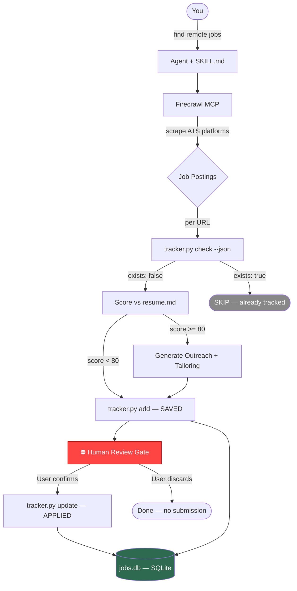

# job-hunter-skill

[](https://python.org)
[](./SKILL.md)
[](https://modelcontextprotocol.io)
[](./tests/test_tracker.py)
[](./LICENSE)

> A production-grade agent skill that automates the remote tech job search and outreach workflow.  
> **BYOK. Zero hosting costs. Zero auto-submit.**

---

## What It Does

`job-hunter-skill` is a cross-platform **Agent Skill** (compatible with Claude Code, Cursor, and Antigravity/Gemini) that runs the full remote job search pipeline locally:

1. **Discovery** — Uses Firecrawl MCP to scrape Greenhouse, Ashby, Lever, and Workable for roles posted in the last 7 days.
2. **Scoring** — Evaluates each job against your local `resume.md` on a structured 0–100 rubric (stack, seniority, remote/LATAM signals, growth scope).
3. **Outreach** — For jobs scoring ≥ 80, generates targeted resume tailoring diffs and a peer-level cold email/DM following strict anti-buzzword guidelines.
4. **Human Gate** — The agent stops and presents everything for your review. **Nothing is ever submitted automatically.**
5. **Tracking** — A lightweight SQLite CLI (`scripts/tracker.py`) deduplicates URLs and logs status across the full pipeline.

---

## Architecture



---

## Project Structure

```
job-hunter-skill/
├── SKILL.md                        # Agent skill entrypoint
├── resume.md                       # Your resume — gitignored, never committed
├── jobs.db                         # SQLite tracker — gitignored
├── references/
│   ├── scoring-rubric.md           # 0–100 job match scoring criteria
│   └── outreach-guidelines.md      # Peer-level outreach writing rules
├── scripts/
│   └── tracker.py                  # CLI tracker — zero external dependencies
├── tests/
│   └── test_tracker.py             # pytest suite (53 test cases)
├── examples/
│   └── resume.example.md           # Resume template
├── README.md
├── LICENSE                         # MIT 2026
└── .gitignore
```

---

## Quick Start

### 1. Clone

```bash
git clone https://github.com/faacu/job-hunter-skill.git
cd job-hunter-skill
```

### 2. Create Your Resume

```bash
cp examples/resume.example.md resume.md
# Edit resume.md with your actual information
```

`resume.md` is listed in `.gitignore` and will never be committed to the repository.

### 3. Initialize the Tracker

```bash
python scripts/tracker.py init
# → [OK] Database initialized at: jobs.db
```

### 4. Configure Firecrawl MCP

Add your Firecrawl API key to your agent's MCP configuration:

**Claude Code** (`~/.claude/mcp_servers.json`):
```json
{
  "firecrawl": {
    "command": "npx",
    "args": ["-y", "firecrawl-mcp"],
    "env": {
      "FIRECRAWL_API_KEY": "fc-your-key-here"
    }
  }
}
```

**Cursor** (`.cursor/mcp.json`):
```json
{
  "mcpServers": {
    "firecrawl": {
      "command": "npx",
      "args": ["-y", "firecrawl-mcp"],
      "env": {
        "FIRECRAWL_API_KEY": "fc-your-key-here"
      }
    }
  }
}
```

**Antigravity** (`~/.gemini/config/mcp_servers/`): Follow the [Antigravity MCP setup guide](https://antigravity.dev/docs/mcp).

### 5. Install the Skill

#### Claude Code
```bash
mkdir -p ~/.claude/skills
cp -r . ~/.claude/skills/job-hunter-skill
```
Then add to your `CLAUDE.md`:
```
@~/.claude/skills/job-hunter-skill/SKILL.md
```

#### Cursor
Reference directly in the chat or `.cursor/rules/`:
```
@job-hunter-skill/SKILL.md
```

#### Antigravity / Gemini
```bash
cp -r . ~/.gemini/config/skills/job-hunter-skill
```
The skill auto-loads from the config skills directory.

### 6. Run

In your agent chat:
```
find remote backend engineering jobs on Ashby and Greenhouse from the last 7 days
```

---

## Tracker CLI Reference

The `tracker.py` script has zero external dependencies (stdlib only: `sqlite3`, `argparse`, `urllib.parse`).

```bash
# Initialize database
python scripts/tracker.py init

# Add a job
python scripts/tracker.py add \
  --url "https://jobs.ashbyhq.com/company/job-id" \
  --company "Acme Corp" \
  --title "Senior Backend Engineer" \
  --score 92 \
  --platform ashby

# Check if URL is already tracked (--json for agent-parseable output)
python scripts/tracker.py check --url "https://..." --json
# → {"exists": true, "company": "Acme Corp", "score": 92, "status": "SAVED", ...}

# List all jobs (--json for structured output)
python scripts/tracker.py list --json
python scripts/tracker.py list --status APPLIED --json

# Update status
python scripts/tracker.py update --url "https://..." --status APPLIED
```

**Valid statuses:** `SAVED` → `APPLIED` → `INTERVIEWING` → `REJECTED`

**Valid platforms:** `greenhouse`, `ashby`, `lever`, `workable`, `other`

### URL Normalization

The tracker automatically strips tracking query parameters before storing or matching URLs. This means these three URLs are treated as identical:

```
https://boards.greenhouse.io/acme/jobs/123
https://boards.greenhouse.io/acme/jobs/123?gh_src=redsols
https://boards.greenhouse.io/acme/jobs/123?gh_src=redsols&utm_source=linkedin&ref=remoteok
```

Stripped parameters include: `gh_src`, `gh_jid`, `ref`, `referral`, `source`, `src`, `utm_*`, `fbclid`, `gclid`, `msclkid`, and others. See `TRACKING_PARAMS` in `scripts/tracker.py` for the full list.

---

## Running Tests

```bash
# Install pytest (only test dependency)
pip install pytest

# Run the full suite
pytest tests/ -v
```

Expected output (40+ tests):
```
tests/test_tracker.py::TestNormalizeUrl::test_strips_gh_src_param PASSED
tests/test_tracker.py::TestNormalizeUrl::test_strips_multiple_utm_params PASSED
...
========= 53 passed in 0.Xs =========
```

---

## Scoring Rubric Summary

Full rubric in [`references/scoring-rubric.md`](references/scoring-rubric.md).

| Category | Weight | What It Measures |
|----------|--------|-----------------|
| Tech Stack Match | 40 pts | Language, framework, cloud, tooling overlap |
| Seniority Alignment | 25 pts | Years, ownership scope, mentorship, IC vs. Lead |
| Remote / LATAM Friendly | 20 pts | Timezone, contractor OK, geo restrictions |
| Scope & Growth Signal | 15 pts | Complexity, autonomy, engineering culture |

| Score Range | Action |
|-------------|--------|
| 90–100 | 🟢 Top Tier — Generate outreach immediately |
| 80–89 | 🟢 Strong Fit — Generate outreach |
| 65–79 | 🟡 Moderate — Save, no outreach |
| 50–64 | 🟠 Stretch — Save only |
| 0–49 | 🔴 Poor Fit — Log and skip |

---

## Security & Privacy

| Concern | How It's Handled |
|---------|-----------------|
| **Local PII** | `resume.md` is `.gitignore`d. It stays on your machine and is only passed to the AI via context window — never to a third-party server by this skill. |
| **BYOK** | Your Firecrawl API key lives in your environment or MCP config. It is never stored in this repository. |
| **Zero Auto-Submit** | The skill enforces a hard Human Review Gate (Phase 4). The agent cannot submit applications, send emails, or trigger form actions without explicit user confirmation in the chat. |
| **No External Telemetry** | `tracker.py` writes to a local SQLite file. No analytics, no callbacks, no network calls. |
| **Credential Hygiene** | `*.db` and `.env` files are gitignored. The example config uses placeholder values only. |

---

## Supported ATS Platforms

| Platform | URL Pattern | Notes |
|----------|-------------|-------|
| Greenhouse | `boards.greenhouse.io/*/jobs/*` | Most common for US startups |
| Ashby | `jobs.ashbyhq.com/*/*` | Growing in Series A/B startups |
| Lever | `jobs.lever.co/*/*` | Common in mid-size tech companies |
| Workable | `apply.workable.com/*/j/*` | Used in both EU and US companies |

---

## Contributing

1. Fork the repository.
2. Create a feature branch: `git checkout -b feat/your-feature`.
3. Write tests for any new functionality in `tests/test_tracker.py`.
4. Ensure all tests pass: `pytest tests/ -v`.
5. Open a pull request with a clear description.

**Code style:** Python type hints required. Zero external runtime dependencies for `tracker.py`. Follow the Clean Code principles in the existing codebase.

---

## License

[MIT License](LICENSE) — Copyright (c) 2026 Facundo Vergara
